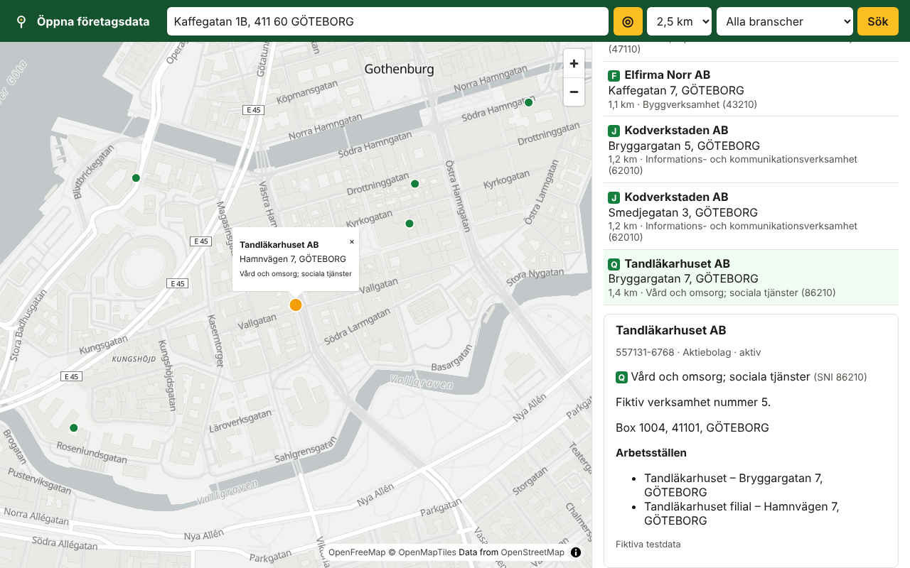

# opendata

Swedish open government data about **legal entities**, their **workplaces**,
**location addresses** and **statistical areas**, served three ways: a PWA, a
GraphQL API and an MCP server. One TypeScript codebase runs on **Cloudflare
Workers** (R2, D1, Workers KV, Email) or as a **Linux** service (filesystem or
S3, SQLite, Valkey/Redis, SMTP), behind storage layers that follow the
[rbq](https://github.com/tabenius/rebsync) object contract.

Natural persons are not in the data: sole traders and estates are dropped at
ingest, and every write and import checks again. See [doc/PRIVACY.md](doc/PRIVACY.md).



## Sources

| Source | What | Access |
|---|---|---|
| SCB företagsregistret API | Companies and workplaces | Free API key from SCB |
| Bolagsverket värdefulla datamängder | Company basics, annual reports | Free OAuth client; bulk file |
| Lantmäteriet belägenhetsadress | Location addresses with coordinates | HVD, CC BY 4.0, after an approved application |
| SCB Statistikdatabasen (PxWebApi v2) | Area statistics | Open, CC0 |
| SCB DeSO | Area boundaries | Open, CC0 |

How to get and load each one: [doc/DATA.md](doc/DATA.md).

## Layout

```text
packages/ports            storage interfaces: ObjectStore, SqlStore, KvStore, Mailer
packages/rbq              rbq contract (vendored), layer snapshots, repository client
packages/adapters-*       object: memory, fs, R2, S3 · sql: SQLite, D1 · kv: memory, SQLite, Redis, Workers KV
packages/mail             Resend, Workers send_email, SMTP; rbq-shaped outbox; area watches
packages/core             schema-backed repository (privacy guard), queries, geodesy, snapshots
packages/sources          SCB FR, Bolagsverket, PxWebApi clients and ingest
packages/datasets         publish/import snapshots as rbq layer `opendata`
apps/api                  Hono + GraphQL Yoga, file downloads, watches, /api/rbq repositories
apps/mcp                  MCP server: Streamable HTTP and stdio
apps/pwa                  Vite + MapLibre PWA
apps/worker               Cloudflare composition root and cron
apps/linux                Linux composition root and CLI
rust/opendata-geo         geodesy and privacy classification, also as wasm
rust/opendata-ingest      bulk ingest into SQLite + snapshot table files
rust/opendata-rbq         publish/verify snapshots with rebsync-core
contracts/                vendored rbq contract; vectors shared by TS and Rust
```

## Quick start (Linux, fictional data)

```sh
pnpm install
pnpm --filter @opendata/pwa build
apps/linux/bin/opendata.mjs ingest fixture --data-dir ./var
apps/linux/bin/opendata.mjs serve --data-dir ./var       # http://127.0.0.1:8787
```

```graphql
{ workplacesNear(address: "Kaffegatan 1, 41160 Göteborg", radiusM: 1000) {
    totalEstimate items { name distanceM organisation { name orgnrFormatted } } attribution } }
```

MCP for Claude Desktop or Claude Code (stdio):

```json
{ "mcpServers": { "opendata": { "command": "/path/to/opendata/apps/linux/bin/opendata.mjs", "args": ["mcp", "--data-dir", "/path/to/var"] } } }
```

Over HTTP the same tools are at `POST /mcp` (optional bearer token).

Deployment on Cloudflare and as a systemd service: [doc/DEPLOY.md](doc/DEPLOY.md).

## Tests

```sh
pnpm typecheck && pnpm test           # TS: unit, conformance, workerd (Miniflare), interop
(cd rust && cargo test --workspace)
```

Optional backends join the conformance suites when available:
`REDIS_URL=redis://127.0.0.1:6379`, `S3_TEST_ENDPOINT=http://127.0.0.1:9455`
(e.g. `moto_server -p 9455`), `RBQ_BIN=/path/to/rbq` for the rbq CLI interop.

## Design documents

- [doc/PLAN.md](doc/PLAN.md): plan and milestone status
- [doc/RBQ-COMPAT.md](doc/RBQ-COMPAT.md): how each layer maps to rbq
- [doc/DATA.md](doc/DATA.md), [doc/DEPLOY.md](doc/DEPLOY.md), [doc/PRIVACY.md](doc/PRIVACY.md)
